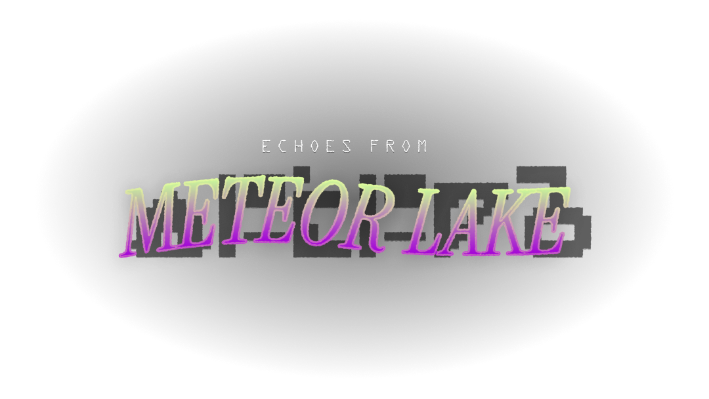
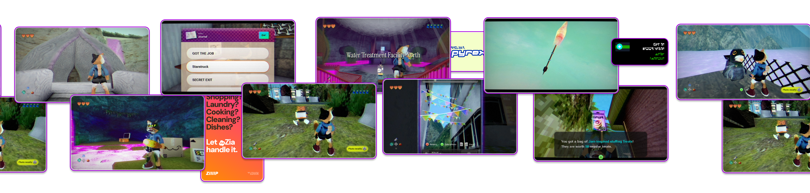

```css
article {
    --color-highlight: rgb(0, 89, 255);
}
.head {
    width:100%;
    margin:auto;
    aspect-ratio: 0.9345;
    background: black url(data-url:pix/echoes-from-meteor-lake/bg.jpg?as=webp);
    background-size: cover;
    overflow:hidden;
    min-height:90vh;
}

.head img {
    max-height: 50vh;
    margin: 20vh auto;
    width: auto;
    height:100%;
    max-width:100%;
    display:block;
    aspect-ratio: 1.77339901;
}

.article-heading {
    display: none;
}


article {
    overflow:hidden;
    max-width:1200px;
    border-radius:3em;
    background: #fff;
    margin:0 auto;
    padding:0;
    font-family: 'Roboto Flex';
    font-style: normal;
    font-weight: 400;
    font-stretch: 80%;
    line-height: 1.2;
    font-size: 1lh; 
    font-variation-settings: 
        'GRAD' -40, 
        'XOPQ' 140, 
        'XTRA' 468, 
        'YOPQ' 79, 
        'YTAS' 750, 
        'YTDE' -203, 
        'YTFI' 738, 
        'YTLC' 514, 
        'YTUC' 712, 
        'slnt' 0;

}

.facts {
    padding: 8vw;
    display:grid;
    gap: 3vw;
    background: #222;
    @media (min-width: 800px) {
        grid-template-columns: 1fr 1fr;
    }


    > * {
        box-shadow: 0px 9px 16.9px rgba(0, 0, 0, 0.5), inset 0px 0px 0px 2px rgba(255, 255, 255, 0.7);
        border-radius:1em;
        overflow:hidden;
        padding: 4vw;
        @media (min-width: 800px) {
            padding:2vw;
        }
        background: #ddd;
        background-image: linear-gradient(to bottom, #fff, #ddd)
    }

    > *:nth-child(1) {
        rotate: 1deg;
    }
    > *:nth-child(2) {
        rotate: -.5deg;
    }
    > *:nth-child(3) {
        rotate: -.4deg;
    }
    > *:nth-child(4) {
        rotate: .1deg;
    }
    > *:nth-child(5) {
        rotate: -.3deg;
    }


    h2 {
        margin: -4vw;
        margin-bottom: 4vw;
        padding: 4vw;
        @media (min-width: 800px) {
            margin: -2vw;
            margin-bottom: 2vw;
            padding: 2vw;
        }
        background: url(data-url:pix/echoes-from-meteor-lake/bg1.png?as=webp);
        background-size:cover;
        color: #000;
        font-size:1.5em;
        text-align:center;
        text-shadow: 2px 2px 1px rgba(0,0,0,.125) ;
        border-bottom: 2px solid #E0A400;
    }
}
h2 {
    line-height:1;
    font-weight: 600;
    font-stretch: 110%;
    font-variation-settings: 'GRAD' 0, 'XOPQ' 114, 'XTRA' 468, 'YOPQ' 60, 'YTAS' 750, 'YTDE' -203, 'YTFI' 738, 'YTLC' 440, 'YTUC' 712, 'slnt' 0;
}
.screens p {
    display:flex;
    width: 400vw;
    flex: 0 0 auto;
    animation: 120s linear 1s infinite running marquee;
    margin: -10vw 0;
    position:relative;
    z-index: 999;
}

.screens{
    display:flex;
    align-items:start;
    background: #000;
}

.screens img {
    width: 50%;
    display:block;
    margin:0;
}

.nfo {
    background: url(data-url:pix/echoes-from-meteor-lake/bg3.jpg?as=webp);
    background-size:cover;
    overflow:hidden;
    padding:10vw;
    text-align:center;
    @media (min-width: 800px) {
        padding:20vw;
    }
}


.intro {
    color: #FFFFFF;
    text-shadow: 3px 3px 2px rgba(0, 0, 0, 0.5);
    padding: 10vw 15vw;
    background: #222 url(data-url:pix/echoes-from-meteor-lake/bg2.png);
    background-size: 4em;
    font-size: 1.25lh; 

    box-shadow: inset 0 0 4em 1em rgba(0,0,0,.2);
    p {
        margin-bottom:3em
    }
    strong {
        font-style: normal;
        font-weight: inherit;
        color: rgb(0, 225, 255)
    }
}

small {
    font-size: .5em;
    line-height: .75;
    opacity: .75;
}

```

```css-glob
@import url('https://fonts.googleapis.com/css2?family=Roboto+Flex:opsz,slnt,wdth,wght,GRAD,XOPQ,XTRA,YOPQ,YTAS,YTDE,YTFI,YTLC,YTUC@8..144,-10..0,25..151,100..1000,-200..150,27..175,323..603,25..135,649..854,-305..-98,560..788,416..570,528..760&display=swap');

@keyframes marquee {

  from {
    translate: 0;
  }

  to {
    translate: -200vw 0;
  }

}

#footer {
    display:none;
}

body {
    background: #000;
}

.article-wrapper {
    padding-inline:0;
}
```

```json
{
  "title": "Echoes from Meteor Lake",
  "desc": "Come visit",
  "date": "1793032079"
}
```

<div class="head">



</div>

<div class="intro">
<div>

The year is **██52**. 

You (Tostada, a cat) and your bff **Churro** (cooler than you, also a cat) are breaking into the dam that surrounds **Meteor Lake** because legend says the water up there is weird and also that’s just what teens do in Islas Verdes because there's nothing better to do.

This is, of course, a *monumentally dumb idea*. Especially now with the dam being an active research site. The night is windy and a small slip sees you both falling down into the water below. 

You appear ashore the day after in a **deep slumber** state. Doctors don't know what to do. Churro is completely missing from the picture. 

After a week the search for Churro has been called off and a small service is held in her **memory**.

After 10 years your phone rings in your slumber.
It’s **Churro**. 
She wants to meet you in Cressida Dam again. 

*Sooo Original.*

</div>
</div>

<div class="screens">




</div>

<div class="facts">

## A changed world
You picked an awful time to sleep through. Since your accident there’s been incredible advances in technology. Sentient robots now run this place. The food delivery website you used for pizza now runs everything? Except food delivery. People just have their assistants cook fresh now.

Your phone is fundamentally useless for any modern life stuff while an ongoing component shortage makes finding a new phone impossible. It’s probably fine that you can’t pay for most things or ride the train. You’ll work this out.

<small>Oh yeah and the water _was_ weird up there. It’s weird everywhere now, problem’s getting worse. As bad as it looks you can just put a purifier in the taps.</small>


## Explore Islas Verdes
The land around Meteor Lake is yours to explore. As you move through the story you’ll collect new items, keys and tools that will let you progress further and further into the islands.

This is a connected world where every corner hides its own little secret. If you played older Zelda titles you already know what to expect.

## Piece the story together
Using your HyperNavigator Pocket you can document the world around you via its camera. Every photo you take unlocks little bits of lore. 

Rumor has it you aren’t the only person interested in this album! You may find extra uses for your snaps later.

## ██ █████ ██ ███ ██████
███ ██ ████ ███ where ██████ ██████ ███ ██ ████ ███ ███ █████████ the ███ ██████ ██ ████ ██████ ██████ Norwood ███ ███████ █████.

## █████ ████ !
███ from ██████ the ███ ███ ███████ ██ ████ ██ ZIIIIP ███ ████ ████ ██████  ███ ████████.


## Meet new friends - and enemies
Islas Verdes is full of friendly colorful folks that will help you in your adventures. Help them on their errands or catch up with them between story beats, they’ll have something cool to say

The world outside town is also full of danger now. Many of the robots have gone rogue and will try to attack you on sight. Your trusty bat will keep them at bay. Hopefully this never has to escalate

</div>

<div class="nfo">

## info

*Echoes from Meteor Lake* is the game I’ve been working on for the last year. It will be coming out on PC in 202█ with opportunities for early access and demos as soon as 202█. Your potato should be able run it. Hopefully?

Broad strokes are all there but please consider all details non final until the game is pressed. I can’t wait for you to try it. 

The best ways to keep yourself updated are this blog (sub to the rss) or my [bsky](https://bsky.app/profile/freezydorito.lol) where I post smaller updates.

-l

</div>